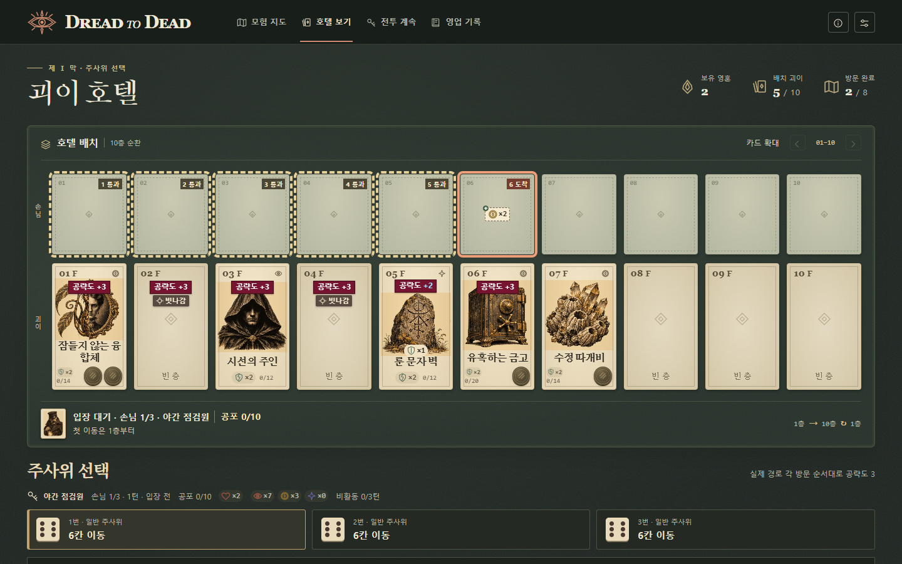

# Dread-to-Dead: Fears Go Round — 아트 및 표현 원칙

> 2026-11-06 · 첫 화면은 **현재 막의 모험 지도**다. 호텔에서는 손님 행과 괴이 행에 종이 카드 열 장씩을 놓는다. [사용자 설정 5](mvps/mvp-config-user-5.md)의 화면과 [텍스트 설정 17](mvps/mvp-config-17.md)의 판정을 함께 따른다.

아래 **모험 지도**와 **종이 카드로 펼친 호텔**은 현재 제작 기준이다. 화면별 조작과 전환은 [모험 UI](ui/adventure.md), [준비 UI](ui/prepare.md), [전투 UI](ui/battle.md)를 따른다. 판정과 명칭은 [공식 룰](rules.md)과 [용어집](terms.md)에서 확인한다.

## 모험 지도

첫 화면과 새로고침 화면은 저장된 막의 지도다. 상단에 막·보유 영혼·배치 괴이 수·완료 방문 수를 두고, 종이 지도 위에 1~3막 진행을 표시한다. 지도에는 현재 막의 여덟 방문 단계와 실제 연결선을 그린다. 넓은 지도는 왼쪽에서 오른쪽으로, 좁은 지도는 위에서 아래로 읽는다. 호텔의 손님·괴이 카드 두 행은 **호텔 보기** 또는 전투 준비·전투 탭에서 펼친다. 상점·융합·회복·보상 탭은 그 방문의 선택을 먼저 보여 준다.

| 지도에서 읽을 정보 | 표현 |
|---|---|
| 어떤 지점인가 | 원형 인장에 지점 종류의 그림과 이름을 함께 둔다. 보스는 큰 이중 테두리 인장으로 표시한다. |
| 어디를 지나왔는가 | 완료 지점에는 작은 체크를 붙이고, 실제로 지나온 연결선은 갈색 실선으로 잇는다. 현재 위치에는 별도의 가는 외곽선을 둔다. |
| 어디로 갈 수 있는가 | 다음 방문 후보는 짙은 녹색 인장으로 채우고, 완료 지점에서 후보로 향하는 연결선은 녹색 파선으로 그린다. 이후의 경로는 가는 점선으로 남겨 다음 분기를 내다볼 수 있게 한다. |
| 어느 지점을 살펴보는가 | 선택한 인장을 적갈색 테두리로 강조한다. 노드 정보에는 방문 순서와 길 이름을 적고, 전투라면 손님 명부를 보여 준다. ‘이 경로 방문’은 실제 방문 후보를 선택했을 때 표시한다. |

짙은 녹색 바탕 위에 종이 결이 보이는 미색 지도와 카드를 놓는다. 제목과 카드명에는 명조 계열 글씨를, 조작 설명에는 고딕 계열을, 중첩 수와 공략도에는 고정폭 숫자를 쓴다. 지도에서는 분기와 인장이, 호텔에서는 카드의 삽화와 수치가 먼저 읽히도록 대비를 둔다. [실제 모험 지도 화면](ui/images/adventure-map.png) · [지도 스타일](mvp_user_5/adventure-map.css) · [카드와 표식 스타일](mvp_user_5/styles.css)

## 1. 종이 카드로 펼친 호텔

**호텔 보드는 2행 × 10열, 종이 카드 스무 장이다.** 왼쪽부터 1~10층을 놓고, 위아래 카드 한 쌍이 같은 층을 나타낸다. 화면이 좁으면 두 행을 함께 가로로 넘긴다.

| 행 | 각 층에 놓이는 카드 | 카드가 바뀌는 시점 |
|---|---|---|
| 위 · 손님 | 현재 손님이 있는 층에 손님 카드 한 장, 나머지 층에 빈 종이 카드 | 입장 전과 손님이 없는 비전투 화면에서는 열 장 모두 빈 카드다. 이동하면 손님 카드는 방문한 층으로 옮겨 가고 직전 층에는 빈 카드가 남는다. |
| 아래 · 괴이 | 점유층에 해당 개체의 삽화·이름이 든 괴이 카드, 빈층에 층 번호가 적힌 빈 종이 카드 | 비전투에서도 배치된 층에 괴이 카드로 표시한다. 재배치는 플레이어가 이동·맞교환을 확정했을 때 적용한다. 획득·융합·폐기·파괴도 판정이 끝난 해당 층에 반영한다. |

### 카드에 인쇄할 정보

- **손님 카드**에는 초상 아래에 이름과 공포 현재값/한계를 둔다. 보드 하단에도 같은 값을 표시해 입장 전이나 화면 밖에 있는 손님의 공포를 읽을 수 있게 한다. 손님 카드와 입구 초상에서 여는 상세에는 공격 패턴·고유 효과·현재 상태를 구분해 보여 준다.
- **괴이 카드**의 왼쪽 위에는 층 번호, 오른쪽 위에는 계열 그림을 둔다. 중앙 삽화 아래에 이름, 파훼 토큰 수, 공략도 현재값/한계를 적는다. 빈층도 같은 크기의 종이 카드로 두고 번호·마름모·‘빈 층’으로 식별한다. 정비 중 괴이를 끌 때는 목적지를 4px 테두리와 ‘이곳으로 이동’ 또는 ‘자리 교환’으로 표시한다.
- **상점·완승 보상 카드**에도 같은 괴이 삽화와 이름을 쓴다. 상점에서는 영혼 가격 또는 품절이 카드에 보인다. 융합체는 원본 A 삽화의 왼쪽 반과 원본 B 삽화의 오른쪽 반을 한 장에 맞붙인다. 상세에도 두 원본의 이름과 본 효과를 같은 순서로 적는다. [괴이 삽화](mvp_user_5/assets/creatures.webp) · [손님 초상](mvp_user_5/assets/guests.webp)
- **속공 금화**는 카드 오른쪽 아래에 놓는다. 밝은 번개 앞면을 누르면 발동하고, 현재 쓸 수 없으면 빗금이 새겨진 어두운 뒷면을 보인다. 융합체에 속공이 둘이면 왼쪽 금화는 A, 오른쪽 금화는 B다. 누른 쪽의 효과와 비용을 적용한 뒤 각 금화의 앞뒷면을 갱신한다. 대상이 필요한 속공은 선택할 수 있는 카드에 4px 테두리를 두고 취소 버튼을 표시한다. 상점·보상 카드의 금화는 뒷면이다.

상태는 **작은 그림과 `×중첩 수`**로 표시한다. 손님에게는 불안(눈)·탐욕(동전)·예언(별)을, 괴이에게는 봉인·잠복·방어·파훼 토큰을 표시한다. 예를 들어 방어 2는 방패 그림과 `×2`다. 0인 일시 상태는 카드에서 생략한다. 카드·상세·예고에 같은 그림을 쓰며, 상태 토큰을 선택하면 이름과 뜻을 읽을 수 있다. [상태 그림과 명칭](mvp_user_5/ui.js)

### 주사위 미리보기

눈에 마우스를 올리거나 키보드 초점을 맞추면 같은 주사위의 결과를 두 행에 동시에 표시한다. 클릭·탭·Enter·스페이스바는 그 눈을 즉시 확정한다. 실제 이동은 속공·탈출구 선택을 마치고 **이동 실행**을 눌렀을 때 시작한다.

| 카드 | 예고 표식 | 읽는 법 |
|---|---|---|
| 위 · 이동 경로 | 4px 테두리와 방문 순서 | 통과층은 점선, 도착층은 실선이다. 같은 층을 다시 지나면 방문 순번을 함께 적는다. 현재 손님의 위치와 아래쪽 선택층도 각각 4px 테두리로 구분한다. |
| 위 · 상태 획득 | 모서리에 작은 `+`가 붙은 점선 칩과 상태 그림 `×획득량` | 그 칸에서 얻을 양을 표시한다. 빈 손님 칸에서는 중앙 마름모 자리에 16px 그림과 12~13px 숫자를 둔다. 손님이 있는 칸에서는 경로 표식 아래에 작게 두어 현재 보유 수량과 구별한다. 재방문으로 같은 상태를 얻으면 그 칸에 합산한다. 이동 전 주사위 효과는 현재 손님 위치에, 입장 전이면 보드 아래 입구에 표시한다. |
| 아래 · 손님 공격 | 층 번호 아래에 검붉은 직사각형 스티커(`#771530`), 흰색 굵은 글씨 **공략도 +N** | 점유층의 N은 실제 공략도 증가량이다. 이미 지닌 방어나 이동 중 얻을 방어가 피해를 흡수하면 `+N`만 하늘색(`#98E0FF`)으로 쓴다. 위력 5에 방어 2면 하늘색 `+3`, 전부 막으면 하늘색 `+0`이다. 빈층에는 원래 위력과 ‘빗나감’을 표시한다. |

방어 소모까지 같은 연속 타격은 스티커 하나에 `×횟수`로 묶고, 결과가 달라지면 실제 타격 순서대로 나눠 붙인다. 대리 피격은 원래 표적에 받을 층을 적고 스티커는 대신 맞는 괴이에게 붙인다. 무작위 비활동 피격은 ‘후보’로 구별한다. 손님 이동은 10층에서 1층으로 순환한다. 이웃·거울 공격은 1~10층 안의 대상에만 표시한다. 예를 들어 거울 감찰관이 1층에 도착하면 3층에만 스티커가 붙는다.



### 실제 방문과 공격

손님은 실제 방문 순서대로 위쪽 칸을 옮겨 간다. 공격할 때는 한 타격마다 아래쪽 대상 카드로 돌진했다가 원래 손님 칸으로 돌아온다. 대리 피격이면 대신 맞는 괴이, 빗나감이면 빈층이 돌진의 끝점이다.

공포를 받으면 손님 카드와 효과를 낸 괴이 카드의 테두리에 보라색 빛을 낸다. 상태 획득은 **불안 적갈색·탐욕 금색·예언 남보라색**으로 번쩍이고 손님 위치에 실선 칩으로 실제 획득량을 표시한다. 두 테두리가 빛나는 약 0.15초 동안은 다음 층으로 이동하지 않는다. 주사위가 발생시킨 효과는 손님 쪽에서만 빛난다. 동작 줄이기를 켠 환경에서는 이동·돌진·섬광 연출을 건너뛰고 판정 후 보드와 수치를 표시한다.

마지막 심장을 잃으면 그 층에서 이동을 마치고 ‘처치’ 도장을 찍는다. 다음 손님은 첫 이동까지 보드 아래 입구에 초상·이름·순번으로 표시한다. 이전 손님 이름과 처치된 층을 함께 적어 같은 손님 종류가 연이어 등장해도 교체 시점을 읽을 수 있게 한다.

<details>
<summary>미채택 연출 후보와 사용자 설정 3의 화면 기록</summary>

### 1.1. 통과·도착의 짝 연출 — 디자인 후보 · 미채택

**아래 내용은 검토용 디자인 후보이며, 채택된 연출 원칙이나 제작 요구사항이 아니다.** 같은 층의 통과와 도착에 서로 관련된 장면을 주어, **‘무사 귀환’과 ‘기믹 발동’을 한 쌍으로 보여 주는 방식**을 검토한다.

같은 장소·사물·위험의 단서를 두 장면에 남기고, 손님의 행동 차이로 결과가 갈리는 모습을 보여 준다. 예를 들어 바닥의 이상한 선을 경계로 삼는 층이라면 다음처럼 구성할 수 있다.

| 방문 | 장면 예시 |
|---|---|
| **통과 — 무사 귀환** | 손님이 바닥의 이상한 선을 넘지 않고 물건만 살펴본 뒤 엘리베이터로 돌아와 다음 층으로 이동한다. |
| **도착 — 기믹 발동** | 손님이 필요한 것을 확인하려고 같은 선을 넘어간다. 그 순간 기믹이 발동하며 공간 전체의 정체가 드러난다. |

플레이어가 두 장면을 경험하며 무엇이 안전과 위험을 갈랐는지 이해하고, 긴 설명 없이도 그 층의 괴이 법칙을 기억하게 하는 것이 목적이다. 이 연출 자체로 전략이 깊어지는 것은 아니지만, 주사위 선택의 결과를 보여 주는 대표 장면으로 활용할 수 있다.

두 장면은 서로 다른 방문 결과에 대응한다. 한 방문에서 통과 장면과 도착 장면을 연속 발동시키지 않으며, 실제 방문이 통과인지 도착인지에 맞는 장면만 보여 준다. ‘무사 귀환’은 해당 층의 탐색을 마치고 엘리베이터로 돌아온다는 뜻이다. 통과 효과로 발생한 수치·상태 변화도 표시하며, 선을 넘는 행동에 별도의 성공 확률이나 추가 선택 판정을 부여하지 않는다.

이 후보에서는 **처음 보는 기믹은 조건·행동·결과를 충분히 보여 주고, 반복 방문은 짧게 처리하는 방식**을 함께 검토한다. 단축하더라도 안전과 위험을 가른 단서, 통과·도착의 차이, 실제 효과의 결과는 남긴다.

연출 참고: 아부부(あぶぶ)의 『アライさんマンション』. 『케모노 프렌즈』의 캐릭터를 사용한 괴담 연작이다. 이 후보의 참고 작품으로 기록하며, 위의 바닥 선 장면은 연출 방식을 설명하기 위한 예시다.

### 1.2. 사용자 설정 3의 호텔 화면 기록

2026-11-01 기준 사용자 설정 3은 10층과 지하에 맞춘 세로 프레임에 보유한 6~10층을 아래부터 그렸다. 1280×720에서 호텔 전체를 고정하고 상품·보관함·설명 목록을 따로 스크롤했다. 획득 전·보관 중 괴이는 카드, 배치 후 괴이는 복도 안의 2D 도형으로 표현했다. [당시 화면 사양](mvps/mvp-config-user-3.md) · [당시 그래픽 MVP](mvp_user_3/README.md)

경유층에서는 손님이 운 좋게 탐색을 마치고 다음 층으로 이동하는 사건을, 최종층에서는 괴이의 기믹에 걸린 사건을 보여준다. **최종층의 방문에는 도착 효과만 발생하므로 통과 효과까지 발동한 것처럼 연출하지 않는다.** ‘운 좋은 탐색’이라는 표현만으로 별도 성공 확률 판정을 만들지 않는다.

괴이의 고유한 작동 법칙과 다른 층에 미치는 영향을 사건으로 전달한다. 공격·수비·지원·액티브는 모두 괴이의 행동으로 표현한다. 한 괴이가 여러 역할을 겸할 수 있으며, 모든 괴이에게 같은 외형·연출 구조를 강제하지 않는다.

## 2. 사용자 설정 3의 대상별 표현 기록

| 대상 | 전달할 내용 |
|---|---|
| **괴이** | 조건 → 행동 → 결과가 이어지는 고유 법칙. 이름·장식뿐 아니라 움직임과 사건으로 역할을 구별한다. |
| **층·엘리베이터** | 실제 배치 단위와 이동 경로. 전체 호텔 프레임을 고정하고 층 번호·문·손님 위치·순번 화살표로 순환을 읽게 한다. |
| **빈층·배경 객실** | 배치 가능한 위치와 장식 공간의 차이. 배경의 방·문을 독립 괴이나 경로 분기로 오해하게 하지 않는다. |
| **공격·지원 연결** | 효과를 낸 괴이, 받는 대상, 소비된 상태, 유지된 연결. 여러 층에 걸친 효과의 실제 대상이 읽혀야 한다. |
| **직접 사용** | 주사위 확정 뒤 첫 이동 전의 사용 가능 층을 표시한다. 대상·잔량·비용·복구 조건을 보여주고, 정보 아이콘·호버·초점은 발동하지 않는다. 대상은 호텔 본체에서 검토하며 클릭·확정 키로 비용을 소비한다. 터치는 같은 대상의 두 번째 탭으로 확정한다. |
| **획득과 상점** | 상점의 괴이 8슬롯·영혼 가격·품절·별도 층 증설, 완승 보상의 기본 괴이 3중 1, 이벤트 획득을 구별한다. 보상 선택과 호텔 배치는 별개이며 블러드 웹·리셋권·상품 개방 연결은 표시하지 않는다. |
| **주사위 장비** | 일반·장거리·짝수·불안 주사위의 전체 이름·모든 면·선택 효과. 발견·엘리트·이벤트의 새 후보 하나와 기존 세 자리를 비교하며, 보스에게 주사위 보상을 표시하지 않는다. |
| **호텔의 일상** | 객실·복도·방송·휴식 등 익숙한 기능이 뒤틀리는 사건을 능력 이해에 활용한다. |

## 3. 사용자 설정 3의 판정 표시 기록

| 장면 | 표시 원칙 |
|---|---|
| **주사위 선택** | 선택 가능한 눈, 이동 층 수, 경유층과 최종층, 각 효과와 손님의 공격 예고. |
| **공포와 영혼** | 손님의 공포 현재값/한계·남은 심장과 구매 잔액인 영혼을 다른 위치·이름·표식으로 구별한다. |
| **심장마비·처치** | 공포 바가 한계까지 참 → 심장 제거 → 공포0의 순서로 보여준다. 중간 심장마비는 무보상이며 마지막 심장 제거 때 영혼 보상과 남은 효과·이동·공격 중단을 보여준다. |
| **방문자 공격** | 실제 공격 대상·순서·타격 수·위력. 미방문층 공격과 재방문에 따른 별도 타격을 구별한다. |
| **괴이 내구·파훼** | 공략도는 1칸=1인 12칸 이산 바와 현재/12 숫자, 파훼 토큰은 채운 심장·빈 심장과 현재/최대 수량으로 표시한다. 개별 타격의 보호 흡수 → 공략도 누적 → 한계12에서 토큰 하나 감소·공략도0을 보여주고 초과분은 버린다. 층·카드·보관함·회복/강화·결과에 같은 표시를 쓴다. |
| **초기화 경계** | 같은 막의 손님 교체·다음 전투에서 토큰은 유지한다. 손님 교체는 공략도0·보호 제거이며 직접 사용 잔량은 유지한다. 다음 전투 준비 최초 진입은 공략도0·보호 제거·직접 사용 초기 잔량이다. 회복 노드의 토큰 합계 최대 2개 배분과 새 막 시작의 모든 생존 개체 최대 토큰 복구를 별도로 표시한다. 공략도0이어도 잃은 토큰의 빈 심장을 채우지 않는다. |
| **능력 실패·재사용** | 조건 부족·자원 부족·횟수 소진·대상 부재를 설명한다. 횟수 복구와 발동 결과의 지속 시간은 따로 표시한다. |
| **영구 파괴·제거** | 파훼 토큰0이면 즉시 빈층으로 바꾼다. 파괴·계약 제거 개체와 강화는 다음 전투·막에서 돌아오지 않는다. 동종 재구매는 새 미강화 개체로 표현한다. |

예고는 공개된 정보로 계산할 수 있는 결과만 보여준다. 미정 판정이나 미래 무작위 결과를 단정하지 않는다. 실제 방문자 위치, 효과 발생 위치, 연출용 대역 위치도 구분한다.

새 막 복구는 1막→2막·2막→3막의 보스 괴이 보상 확정 뒤, 생존한 배치·보관 개체의 파훼 토큰을 각각 최대치로 채운다. 그 시점의 강화·공략도·사용 잔량·배치·영혼·장비는 유지하며 최종 승리에서는 토큰을 복구하지 않는다. 안내·기록으로 경계를 알리되 복구를 승인하는 추가 버튼은 만들지 않는다.

</details>

## 반복 연출과 제작 기록

연쇄 연출을 단축하거나 겹쳐도 실제 순서·횟수·소비량·원인과 결과를 유지한다. 같은 층 재방문은 현재 방문이 경유인지 최종 도착인지 구별한다. 긴 장면을 매번 재생하지 않아도 법칙이 읽혀야 한다.

음향은 괴이의 작동·층 이동·기믹 발동을 구별하는 데 쓸 수 있다. 어둠·큰 소리·점프 스케어·유혈·전체 음성 더빙을 공통 필수로 삼지 않는다.

```markdown
### 대상 이름 / 지도·손님 카드·괴이 카드·상점 등 구분
- 결정 상태 / 참조 규칙·능력 명세:
- 핵심 법칙과 손님이 경험하는 사건:
- 통과·도착·피격·속공 중 해당하는 발동 시점:
- 실제 위치·효과 대상·입력→결과의 표현:
- 실패·파훼·초기화 / 첫 장면과 반복 시 최소 표현:
- 외형·색·동작·음향 제안 / 미정 제작 사양 링크:
- 검토 결과: 법칙 이해·대상 판독·예고와 결과 일치:
```

검토는 [능력 체크리스트](ability_checklist.md)의 법칙·공간·정보 전달 항목과 연결한다. 메커니즘 참고 작품을 외형·색·화풍의 기준으로 자동 채택하지 않는다.
