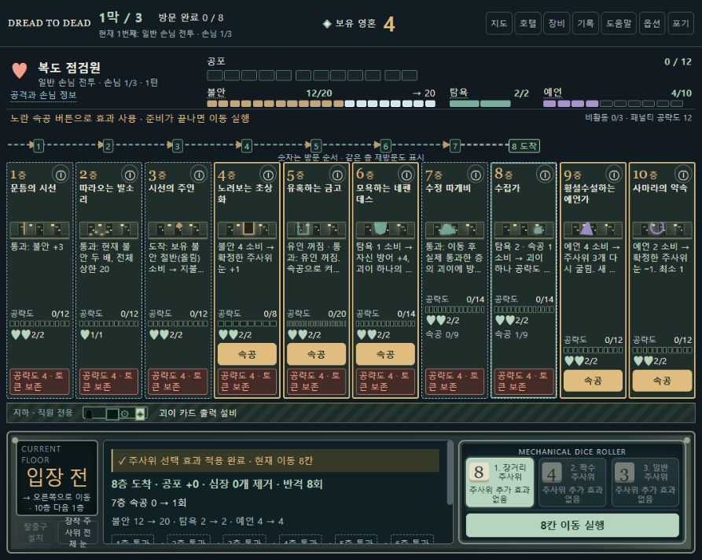

# Dread to Dead · 사용자 실험 4

[설정 user-4 v1.2](../mvps/mvp-config-user-4.md)의 13종 괴이·불안·탐욕·예언·속공을 사용하는 로컬 웹 프로토타입이다. 구매·배치·전투·보상·회복·강화·막 전환·최종 승리·패배·새 판까지 구현했다. 기존 user-3 실행본과 공통 규칙 문서는 별도로 유지한다.

2026-11-03의 v1.2는 **첫 전투와 이후 손님 수치를 완화**하고, **불안·탐욕·예언·봉인·화재·속공 상한을 모두 99**로 통일했다. 괴이의 가격·효과량·비용·공략 한계·파훼 토큰, 초기 배치, 지도·경제·보상은 유지한다. 손님별 현재 공포 한계·심장·공격은 [설정 §2.1](../mvps/mvp-config-user-4.md#21-손님-수치--user-4-v12)과 [실행 수치](enemies.mjs)에서 확인한다.

## 실행

Node.js 20 이상에서 [play.cmd](play.cmd)를 더블클릭한다. 또는 이 폴더에서 `npm start`를 실행하고 <http://127.0.0.1:4175>를 연다. 별도 설치 패키지나 빌드는 없다. 서버 창을 닫거나 Ctrl+C로 종료한다. 포트가 사용 중이면 이전 서버를 종료하거나 `PORT` 환경 변수로 바꾼다.

페이지 새로고침은 현재 판을 초기화한다. 옵션·설명 확인 이력만 브라우저에 저장한다. 결과와 전체 진행 기록은 게임의 **기록 내려받기**로 저장한다.

## 가로 호텔과 조작

- **왼쪽 1층 → 오른쪽 마지막 층 → 다시 1층** 순서다. 최대 10층을 한 줄에 표시하고 창 너비에 맞춰 층 너비를 조정한다. 증설은 오른쪽에 빈층을 추가한다. 주사위·이동·탈출구 조작은 호텔 아래에 있다.
- 구매·보관·보상은 카드, 배치는 층 박스다. 카드의 **배치하기 → 층 선택**, 또는 드래그로 이동·교환한다. 층에 마우스/키보드 초점을 두거나 정보 버튼을 누르면 전체 카드와 효과를 확인한다.
- 주사위 굴리기 → 세 후보 검토 → 하나 확정 → 필요한 속공 → 이동 실행 순서다. 경로 위 숫자는 방문 순서이며 순환·재방문도 표시한다.
- 노란 **속공** 버튼은 사용 가능한 층에 나타난다. 목표가 필요한 효과는 대상 층을 살펴본 뒤 클릭해서 비용을 지불한다. 취소·검토에는 비용이 없다. 터치 대상 선택은 한 번 검토, 같은 층을 다시 눌러 확정한다.
- 괴이별 공략 한계 8·12·14·18·20은 1단위 바, 남은 파훼 토큰은 심장으로 표시한다. 손님의 불안·탐욕·예언, 현재 상태와 공격 예고를 함께 확인한다.
- 첫 등장 안내는 옵션에서 끌 수 있다. 도움말의 괴이 사전과 용어 설명은 언제든 볼 수 있다. 매우 낮은 창에서는 페이지를 세로로 스크롤할 수 있다.

위 이미지는 2026-11-02의 v1.1 화면 검사용으로 구성한 10층 상태다. 현재 v1.2의 상태 상한 99는 반영하지 않았으며, 정상 플레이로 획득한 결과는 아니다. [당시 정적 화면](validation/hotel-10.html)은 버튼이 동작하지 않으며 실제 게임은 루트 주소에서 실행한다.

## 이번 실험의 판정

초기 6층·영혼 4·일반 주사위 3개로 시작하며 문틈의 시선 1층, 시선의 주인 3층, 룬 문자 벽 5층, 유혹하는 금고 6층을 보유한다. 막당 8개 노드를 방문해 세 막의 보스를 모두 처치한다. 보스 처치 뒤 필수 괴이 보상을 선택하면 다음 막 또는 최종 승리로 간다. 어느 막이든 보스 탈출은 패배다.

사용자가 확정한 수정 따개비의 방어는 **이동을 마친 뒤 실제 통과한 모든 층**에 적용하며 최종 도착층은 제외한다. 13종의 가격·기본값·강화값은 요청 표를 따랐다. 빈칸은 다음 제작 기본값으로 채웠다.

- 탐욕·예언은 불안처럼 손님별 자원이며 다음 손님에서 0이 된다. 보유 상한은 세 자원 모두 99다. 봉인·화재·속공도 상한 99를 사용하며, 괴이 파훼 토큰과 손님 심장은 이 상한 변경의 대상이 아니다.
- 초기 속공이 빈 괴이는 별도 횟수 제한 없이 명시된 자원 비용을 지불한다. 수정 따개비는 0회, 수집가는 1회로 매 전투를 시작하고, 저장 상한은 99회다.
- 예언은 **주사위를 실제 선택할 때** 보유량이 선택 눈보다 큰 경우만 발동한다. 재굴림 뒤 재선택은 새 선택이고, 눈 증감 속공은 재발동하지 않는다. 기본 예언가는 재굴림 최솟값을 환급하고 강화형은 비용 1·환급 없음이다.
- 시선의 주인은 보유 불안 절반을 올림해 소비한다. 따라오는 발소리 강화는 현재·최대 파훼 토큰을 1 늘린다. 파괴된 괴이는 복구하지 않는다.

전체 수치와 대리 피격·상태·경계 처리 순서는 [설정 문서](../mvps/mvp-config-user-4.md)에 기록했다.

## 현재 v1.2 검증

2026-11-03, 적 수치 완화와 여섯 상태 상한 99를 함께 적용한 최종 코드에서 `npm test` **71개 통과**: 규칙 44개, 오프라인 UI 19개, 적 수치 8개. 강제 경계 상태를 사용하는 검사와 아래의 합법 플레이 성과를 구분한다.

첫 전투는 난수 번호 **31001~31020 × 세 시작 경로 × 두 공개 정보 정책 = 120회**를 이전 수치와 비교했다. 기본 배치를 유지하고 추가 자산·탈출 없이 실행했다.

| 첫 전투 비교 | 이전 v1.1 | 현재 v1.2 · 상한 99 |
|---|---:|---:|
| 완승 | 1 / 120 | 120 / 120 |
| 전체 시도당 평균 턴 | 32.8 | 13.0 |
| 괴이 파괴 | 477개 | 0개 |
| 파훼 토큰 손실 | 957개 | 0개 |

평균 턴은 성공·실패를 모두 포함한 각 시도의 평균이며, 완승한 판끼리만 비교한 수치가 아니다. 첫 전투의 괴이 4개·토큰 8개가 현재 검사 120회에서 모두 남았다. [이전 원자료](validation/balance-v1.2/opening-before.json) · [최종 상한 99 원자료](validation/balance-v1.2/opening-final-99.json)

전체 캠페인은 같은 분산 배치 정책과 지정 세 난수 번호로 다시 실행해 **2승 1패**였다. 이전 수치의 같은 정책은 세 판 모두 첫 전투에서 패배했다.

| 난수 번호 | 결과 | 완료 방문 | 턴 | 괴이 파괴 | 회복한 토큰 | 탈출 |
|---|---|---:|---:|---:|---:|---:|
| 31001 | 최종 보스·필수 보상 완료 | 24 | 159 | 1 | 6 | 0 |
| 31002 | 3막 두 번째 일반 전투에서 전멸 | 17 | 171 | 8 | 2 | 0 |
| 31003 | 최종 보스·필수 보상 완료 | 24 | 132 | 0 | 1 | 0 |

[최종 전체 캠페인 원자료](validation/user-4-v1.2/campaign-spread-summary.json) · [현재 검증 요약](validation/summary.json) · [이전 동일 정책](validation/campaign-spread-summary.json)

오늘 브라우저에서는 첫 전투의 공포 한계 4·5, 심장 1개, 개별 공격 1과 상태 상한 99 표시, 주사위 선택 뒤 공격 예고를 확인했다. 이동 실행은 하지 않았으며, 사용자 요청에 따라 추가 화면 플레이를 생략했다. 아래의 2026-11-02 첫 턴·10층 화면 검사는 과거 기록으로 유지한다.

첫 전투 완화와 합법 캠페인 완주 가능성을 확인했지만, 모든 경로·조합의 성공이나 사람의 난이도 체감·재미를 입증하지는 않는다. 상태 상한 변경 전의 적 수치 조정안은 [별도 보존 자료](validation/balance-v1.2/enemies-only/campaign-spread-summary.json)이며, 당시 3승을 최종 상한 99의 성과로 합산하지 않는다. 더 이른 완화 후보도 최종 수치와 구별한다.

## 이전 v1.1 검증 — 2026-11-02

다음은 **적 수치 완화와 상태 상한 99를 적용하기 전**의 검사·플레이 기록이다. 현재 v1.2 성과와 합산하지 않는다.

Node.js 24.12.0에서 당시 `npm test` **59개 통과**: 규칙 41개, 오프라인 UI 조작·표시 18개. 강제 경계 상태를 사용하는 검사이며 정상 플레이 성과와 구별한다. 당시 HTTP 서버에서 HTML·CSS·JavaScript 모듈 7개가 200과 올바른 MIME으로 제공되는 것도 확인했다.

당시 실제 브라우저에서는 새 판 → 지도 방문 → 준비 → 굴림 → 선택 → 금고 속공 → 이동을 조작했다. 10층 정적 상태는 약 892×712 CSS 픽셀 창에서 모든 층 박스가 화면 안에 있고 한 줄인 것을 화면과 DOM 경계로 확인했다. 전체 캠페인의 브라우저 자동 조작, 모바일 터치 및 모든 해상도는 검증하지 않았다.

공개 정보와 합법 명령만 사용하는 자동 정책 네 가지로 지정 난수 번호 31001·31002·31003을 각각 실행해 **12판 모두 패배**했다. 초기 세 정책은 첫 전투에서 실패했다. 탈출을 선택지에 포함한 정책은 다음까지 진행했다.

| 난수 번호 | 완료 방문 | 패배 위치 | 턴 | 처치 / 탈출 |
|---|---:|---|---:|---:|
| 31001 | 7 | 1막 보스 | 47 | 0 / 3 |
| 31002 | 23 | 3막 최종 보스 | 148 | 5 / 8 |
| 31003 | 15 | 2막 보스 | 104 | 2 / 6 |

당시 승리 화면과 종료 처리는 경계 검사에서 확인했지만 정상 캠페인 승리는 확인하지 못했다. 요청받은 괴이 수치를 이 결과에 맞춰 조정하지 않았으며, 이번 v1.2의 적 수치 완화는 후속 사용자 요청에 따른 별도 변경이다.

- [당시 초기 밀집 배치 3판](validation/campaign-summary.json) · [당시 분산 배치 3판](validation/campaign-spread-summary.json) · [당시 공포 우선 3판](validation/campaign-aggressive-summary.json) · [당시 탈출 포함 3판](validation/campaign-survival-summary.json)
- [당시 기계 판독용 검증 요약](validation/summary-v1.1.json)

## 검증 다시 실행

- `npm test`: 현재 규칙과 오프라인 UI 검사를 실행한다. 정상 플레이 성과와 별도다.
- `node verify-opening.mjs final-99 20`: 난수 번호 31001~31020의 세 시작 경로를 두 공개 정보 정책으로 실행한다. 시작 배치를 유지하고 추가 자산·탈출 없이 각 정책 60회, 총 120회 검사한다. 출력은 `validation/balance-v1.2/opening-final-99.json`이다.
- `node verify-campaign.mjs`: 분산 배치 정책으로 지정 세 번호를 실행한다. `--compact`, `--aggressive`, `--survival`로 다른 정책을 선택하고 선택적 인수로 난수 번호를 넣는다. 현재 로그는 `validation/user-4-v1.2/`에 저장해 이전 버전 기록을 보존한다.
- `node verify-layout.mjs`: 현재 UI 코드로 10층 정적 화면을 다시 생성한다. 게임 진행이나 난수·자산을 저장하는 기능이 아니다.
