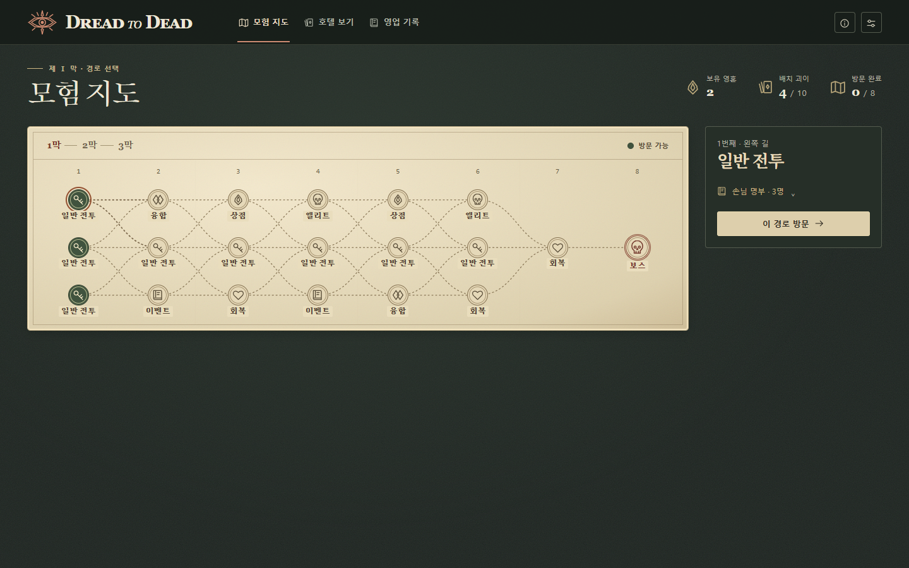

# 모험 지도와 노드 화면

> 그래픽 MVP 5의 모험 화면 기록(텍스트 설정 17). 현재 텍스트 MVP 21의 막·방문·보상은 [원정 규칙](../rules.md#adventure)에 있다.

그래픽 MVP 5에서 새 판의 첫 화면은 **1막 모험 지도**다. 저장된 판을 다시 열면 진행 중인 막의 지도가 먼저 보인다. 지도에는 방문 지점과 연결선을 그리고, 손님 칸과 괴이 칸은 호텔 화면에 둔다.

## 지도에서 호텔로, 호텔에서 지도로

| 플레이어의 조작 | 열리는 화면 |
|---|---|
| **모험 지도**를 누른다 | 현재 막의 지도와 선택한 노드의 정보를 표시한다. 진행 중인 방문과 전투는 저장된 단계에 머문다. |
| **호텔 보기**를 누른다 | 위쪽 손님 10칸과 아래쪽 괴이 10칸이 같은 층끼리 맞물린 호텔 보드를 연다. 정비 가능한 단계에서는 여기서 카드를 옮기거나 맞바꾼다. [호텔·준비 UI](prepare.md) |
| 일반·엘리트·보스 노드를 방문한다 | **전투 준비** 탭이 열리고 호텔과 손님 명부가 함께 보인다. 배치를 마치고 **영업 시작**을 누르면 같은 보드에서 주사위를 고른다. 전투 중 지도를 살펴본 뒤에는 **전투 계속**으로 복귀한다. [전투 UI](battle.md) |
| 상점·융합·회복·이벤트에 들어가거나 보상을 받는다 | 해당 단계의 선택지를 먼저 표시한다. 배치를 확인하려면 **호텔 보기**, 결정을 이어가려면 상단의 해당 진행 탭을 누른다. |
| 노드의 마지막 결정을 마친다 | 방문 횟수가 한 번 올라가고 다음 경로가 열린다. 1·2막 보스 보상 뒤에는 다음 막의 지도, 3막 마지막 보상 뒤에는 승리 결과가 열린다. |

상단에는 현재 막·진행 단계, 보유 영혼, 배치 괴이 수 `/10`, 이번 막의 방문 완료 수 `/8`을 표시한다. 같은 노드의 전투 준비, 보상 선택, 획득한 카드 배치는 한 번의 방문에 속한다.

## 경로 읽기와 방문

- 한 막에는 **20개 지점 중 여덟 곳**을 방문한다. 1~6번째에는 좌·중·우 세 갈래가 있다. 첫 방문은 셋 중 하나를 고르고 이후에는 연결선을 따라 다음 깊이의 같은 갈래 또는 이웃 갈래로 간다. 6번째의 세 길은 7번째 공통 회복에서 합쳐지고 8번째 보스로 이어진다. 지도 숫자는 방문 순서다.
- 넓은 화면에서는 왼쪽에서 오른쪽으로 진행하며 선택 정보가 지도 오른쪽에 놓인다. 좁은 화면에서는 정보 패널이 먼저 보이고, 지도 폭이 더 좁아지면 첫 방문이 위, 보스가 아래인 세로 배치로 바뀐다. 상단의 **1막 · 2막 · 3막** 표시는 현재 막과 완료한 막을 알려 준다.
- 노드를 클릭·탭하거나 키보드로 활성화하면 **검토할 지점만** 바뀐다. 방문 가능한 노드와 진행 중인 노드는 녹색 인장, 완료한 노드는 체크 표시로 구분한다. 선택한 노드는 별도 테두리를 두르고, 정보 패널에는 종류·방문 순서·갈래가 표시된다.
- 전투 노드는 방문하기 전에도 **손님 명부**에서 순서, 공포 한계, 심장, 공격을 살펴볼 수 있다. 이름을 누르면 공격 패턴과 고유 효과를 연다. 상점 재고와 이벤트 제시물은 방문 확정 때 공개한다.
- 진행은 연결된 노드의 **이 경로 방문**을 눌렀을 때 확정한다. 예를 들어 1막 지도에서 보스를 눌러 패턴을 읽은 뒤 첫 갈래로 돌아가도 방문 수는 `0/8`이다. 전투 준비에서 지도를 다시 열어도 새 갈래를 고를 수 있는 시점은 현재 방문을 마친 뒤다.

## 방문별 결정과 보상

| 방문 | 화면에서 내리는 결정 | 다음 단계 |
|---|---|---|
| 일반 전투 | 손님 세 명을 차례로 상대한다. 완승하면 서로 다른 괴이 카드 세 장 중 한 장을 고른다. | 새 카드 처리 뒤 지도 |
| 엘리트 | 한 명을 상대한다. 완승하여 괴이 보상을 처리한 뒤 특수 주사위의 눈과 효과를 확인한다. | 장착한 세 자리 중 하나와 교체하거나 건너뛴 뒤 지도 |
| 보스 | 한 명을 상대하고 완승 보상의 새 카드를 처리한다. | 1·2막은 생존 괴이의 파훼 토큰을 최대치로 복구한 뒤 다음 막, 3막은 승리 결과 |
| 융합 | 두 미융합 괴이를 A·B 순서로 골라 본 효과·강화·내구·비워질 층을 비교한다. 순서를 바꿔 볼 수 있다. | 한 쌍의 비가역 융합을 무료로 확정하거나 건너뛴 뒤 지도 |
| 상점 | 여덟 상품의 가격과 보유 영혼을 비교한다. 구매한 슬롯에는 품절을 표시한다. | 새 카드 처리 뒤 같은 상점으로 돌아온다. **상점 떠나기**로 방문 완료 |
| 회복 | 호텔 전체에 파훼 토큰을 합계 두 개까지 배분하거나, 한 개체의 강화를 고른다. | 회복·강화 확정 또는 건너뛰기 뒤 지도 |
| 이벤트 | 짐에서는 주사위 교체·영혼 수령·건너뛰기, 봉인된 객실에서는 제시 카드 구매·건너뛰기, 교단 계약에서는 제거할 괴이·지급액을 확인하고 계약·건너뛰기를 고른다. | 새 괴이를 구매했다면 배치·폐기까지 처리하고 지도 |

**카드 선택과 층 배치는 별도 결정이다.** 보상·구매로 새 괴이를 얻으면 빈층에 놓거나 새 카드를 버린다. 열 층이 모두 찼다면 교체할 괴이의 층과 이름을 보고 확정하거나 새 카드를 버린다. 보상 처리가 끝나면 획득 출처에 따라 위 표의 다음 단계로 간다. 일반·엘리트에서 손님이 탈출하면 완승 보상 없이 지도로 돌아가고, 보스가 탈출하면 패배 결과가 열린다.

## 기록과 재개

**영업 기록**에는 방문별 행동과 전투 결과, 막별 수입·구매·완승 보상·융합·강화 횟수, 처음 만실이 된 시점이 남는다. 지도를 넘나들거나 손님 상세를 읽는 동안에는 방문·구매·주사위 결과가 확정되지 않는다. **설정 및 새 판**에서는 판 번호를 지정하고 새 판 시작을 확정할 수 있다. 실행·저장 방법은 [플레이 안내](../mvp_user_5/README.md), 지도의 색·아이콘과 호텔 카드의 인쇄 기준은 [아트 문서](../arts.md)를 따른다.
