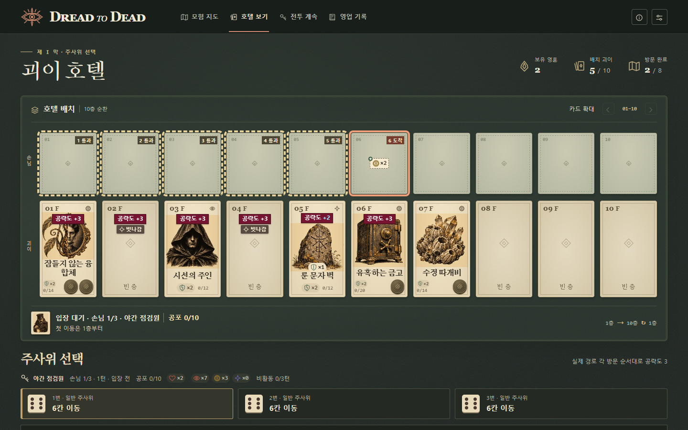

# 전투 UI 설계

> 2026-11-06 · 그래픽 MVP 5의 전투 화면과 입력 기준. [사용자 설정 5](../mvps/mvp-config-user-5.md) · [17판 전투 규칙](../mvps/mvp-config-17.md) · [아트 및 표현 원칙](../arts.md)

모험 지도에서 전투 노드를 방문하면 **전투 준비** 탭에 호텔과 손님 명부가 열린다. 배치를 마치고 **영업 시작**을 누르면 첫 손님이 입구에서 기다리고 세 주사위의 눈이 공개된다. 진행 중 지도로 나갔다면 **전투 계속**으로 같은 턴에 복귀한다. 경로와 배치 조작은 [모험 UI](adventure.md)와 [준비 UI](prepare.md)를 따른다.

## 호텔 보드에서 읽는 정보

호텔은 왼쪽부터 1~10층인 **2행 × 10열 종이 카드**다. 같은 열의 위아래 카드가 한 층이다. 좁은 화면에서는 두 행을 함께 가로로 넘긴다. 카드 확대와 이전·다음 층 버튼은 두 행에 함께 적용한다.

| 위치 | 표시와 조작 |
|---|---|
| 위쪽 손님 칸 | 손님이 있는 층에 초상·이름·현재 공포/한계를 표시하고 나머지는 빈 종이 카드로 둔다. 손님 카드나 입구 초상을 누르면 공격 패턴·고유 효과·현재 상태를 읽을 수 있다. 현재 고유 효과가 없는 손님은 ‘없음’으로 표시한다. |
| 아래쪽 괴이 칸 | 점유층에는 삽화·이름·공략도 현재/한계·파훼 토큰을, 빈층에는 층 번호와 ‘빈 층’을 표시한다. 카드를 선택하면 4px 테두리가 생기고 상세에서 본 효과·강화·내구를 읽는다. 융합체의 상세에는 원본 A와 B의 이름과 효과가 함께 나온다. |
| 상태 토큰 | 불안·탐욕·예언과 봉인·잠복·방어 등은 작은 상태 그림과 `×중첩 수`로 표시한다. 보유 토큰을 누르면 뜻을 볼 수 있다. 공포와 공략도는 현재값/한계 숫자로 읽는다. |
| 보드 아래 | 입구 또는 현재 층, 손님 이름과 공포를 표시한다. 주사위 선택 영역에서 손님 순번·턴·남은 심장·보유 상태·비활동 수치를 확인한다. |

## 주사위를 고를 때

각 주사위에서 자리 번호·종류·눈을 확인한다. 처음에는 1번 주사위 기준 예고를 보여 준다. 다른 눈에 마우스를 올리거나 키보드 초점을 옮기면 그 눈의 예고로 바뀐다. 이때 주사위, 자원, 손님 위치는 그대로다. **주사위를 한 번 클릭하거나 탭하면 그 자리의 눈이 즉시 확정된다.** 키보드는 초점을 맞추고 Enter 또는 스페이스바를 누른다. 확정 직후에는 **이동 준비**가 열린다.

| 어디를 보는가 | 해당 주사위로 진행할 때의 예고 |
|---|---|
| 위쪽 칸의 테두리 | 통과 예정층에는 4px 점선, 도착 예정층에는 4px 실선과 방문 순서를 표시한다. 손님은 10층 다음에 1층을 방문하며, 같은 층을 다시 지나면 방문 순서를 함께 적는다. |
| 위쪽 칸의 상태 그림 | 획득할 상태를 그때 손님이 있을 칸에 점선 표식과 `그림 ×획득량`으로 표시한다. 미강화 문틈의 시선을 통과하면 해당 칸에 불안 그림 `×4`가 뜬다. 같은 층에서 같은 상태를 여러 번 얻으면 합산하고, 상한으로 줄어든 실제 획득량을 쓴다. 이동 전 주사위 효과는 현재 위치에, 입장 전이면 입구에 표시한다. |
| 아래쪽 칸의 공격 스티커 | 공격받을 칸에 검붉은 직사각형과 흰색 굵은 글씨로 **공략도 +N**을 표시한다. 괴이의 N은 해당 타격으로 실제 증가할 공략도다. 이미 가진 방어나 이동 중 얻을 방어가 피해를 흡수하면 **숫자 부분만 하늘색**이다. 위력 5에 방어 2면 하늘색 `+3`, 전부 막으면 하늘색 `+0`이다. 빈층에는 원래 공격 위력과 ‘빗나감’을 함께 표시한다. |
| 대리·연속·무작위 피격 | 대리 피격이 있으면 원래 표적에는 공격이 향하는 층을 쓰고 스티커는 실제 수신층에 붙인다. 같은 결과의 연타는 `×횟수`로 묶고 방어 소모로 결과가 달라지면 순서대로 표시한다. 무작위 비활동 피격은 후보를 따로 표시한다. |
| 보드 아래 판정 상세 | 이동 순서와 손님의 공격 순서를 나누어 보여 준다. 상세를 펼치면 방어 흡수·공략도 증가·파훼 토큰 손실·처치와 탈출 등 각 판정을 확인할 수 있다. |

도착층을 기준으로 좌우를 치는 공격은 1~10층 안의 대상만 친다. **거울 감찰관이 1층에 도착하면 공격 스티커는 3층에만 뜬다.** 경로 공격은 실제 방문한 순서를 따르므로 이동 경로가 10층에서 1층으로 이어졌다면 두 층 모두 공격할 수 있다.

이 장면에서 5층 룬 문자 벽은 위력 3 중 방어 1을 흡수하므로 하늘색 `+2`가 붙는다. 위쪽 6층의 탐욕 그림 `×2`는 손님이 도착한 자리에서 반격을 마치며 얻을 양이다.

## 이동 준비와 속공 금화

속공이 있는 괴이 카드는 **오른쪽 아래에 금화**를 둔다. 사용할 수 있는 금화는 밝은 번개 앞면, 사용할 수 없는 금화는 어두운 빗금 뒷면이다. 밝은 금화를 눌러 해당 속공을 발동한다.

- 대상 지정이 필요한 효과는 금화를 누른 다음 강조된 괴이 카드를 선택해야 발동한다. 이 단계에서 **취소**나 Esc를 누르면 비용을 쓰지 않는다. 키보드로도 금화와 유효한 대상 카드를 차례로 선택할 수 있다.
- 융합체의 두 금화는 **왼쪽이 원본 A, 오른쪽이 원본 B**다. 누른 원본의 비용·강화·대상 조건을 적용하고, 처리 후 두 금화의 사용 가능 여부와 이동·공격 예고를 갱신한다.
- 필요하면 **탈출구**에서 빈층을 골라 설치한다. **이동 실행**을 눌렀을 때 손님이 출발한다. 이동 도중 처치되거나 탈출구에 닿으면 그 지점까지 재생한다.

## 실제 이동과 손님 교대

1. 손님 카드는 위쪽 행의 방문 순서대로 움직인다. 중간층에서 통과 효과를, 마지막 층에서 도착 효과를 처리한다. 융합체의 두 본 효과가 같은 시점에 발동하면 A부터 처리한다.
2. 공포가 오르면 효과를 낸 괴이 카드와 손님의 현재 칸에 보라색 테두리가 약 0.15초간 번쩍인다. 불안은 적갈색, 탐욕은 금색, 예언은 남보라색 테두리와 실제 획득량 그림을 쓴다. 주사위 효과는 손님 쪽에 표시한다. 손님은 해당 연출을 마친 뒤 다음 칸으로 이동한다.
3. 살아남은 손님이 공격하면 손님 카드가 아래쪽의 실제 대상 칸으로 돌진했다가 위쪽 원래 자리로 돌아온다. 연타는 한 타격씩 재생한다. 파훼 토큰이 소진되어 파괴된 괴이의 자리는 빈 카드가 된다.
4. 공포가 한계에 닿으면 심장이 하나 줄어든다. 남은 심장이 있으면 공포가 0이 되고, 마지막 심장을 잃으면 처치된 층에 **처치** 도장이 찍힌다. 다음 손님은 보드 아래 입구에 대기한다. 입구의 손님 순번과 직전 처치 기록으로 교대를 구분하고, 새 손님의 첫 이동은 1층부터 시작한다.

모션 줄이기 설정에서는 이동·돌진·점멸 연출을 생략하고 판정 결과를 표시한다. 노드 완승 후에는 보상 화면으로 넘어가며, 영혼·처치·괴이 파괴 내역은 **영업 기록**에서 확인한다. 일반·엘리트 손님이 탈출하면 지도로 돌아가고, 보스 탈출이나 괴이 전멸은 패배 결과로 이어진다.
